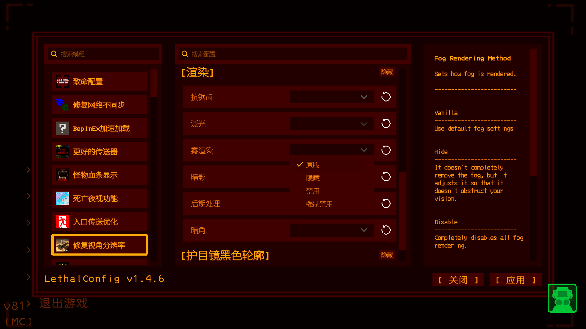
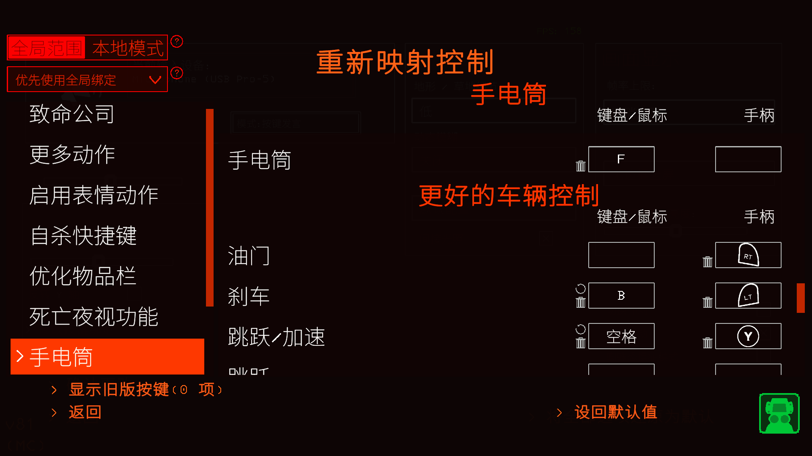
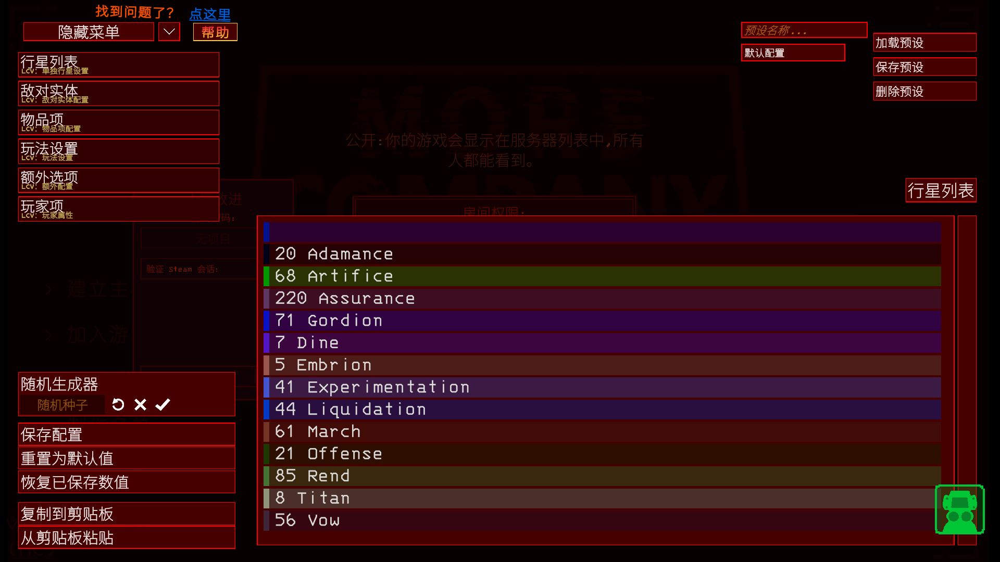

# Chinese_moduleconfiguration
这是一个专门为模组配置制作的中文翻译包，翻译了部分比较实用的模组配置

## 前置要求
1. GameTranslator (CoolLKK_Group)
2. LC Chinese Project (Aueser)
3. BepInExPack

## 原因
1. 该包用的是GameTranslator进行配置翻译的所以要使用GameTranslator
2. 该包没有内置游戏原版翻译因为有更好的LC Chinese Project这个汉化模组，所以绑定安装LC Chinese Project

## 模组配置翻译预览

## 安装方式
使用 r2modman 安装，管理器会自动下载全部前置依赖

## 使用说明
1. 安装本包，r2会自动拉取下载GameTranslator和LC Chinese Project
2. 启动游戏
3. 打开模组配置，只要是该包翻译的模组，配置菜单文字会变成中文

## 注意事项
- 翻译文件路径：`BepInEx\config\translations\Default\Normal-Translate.cfg`
- 该包翻译并非100%正确，但是保留了原版英文配置右上角详细页面，方便查看原名字